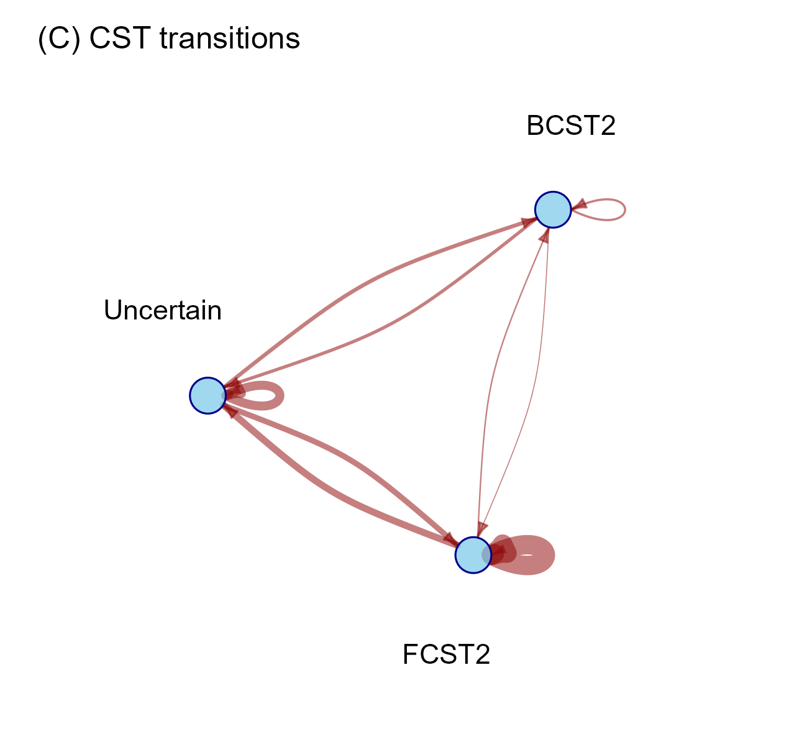
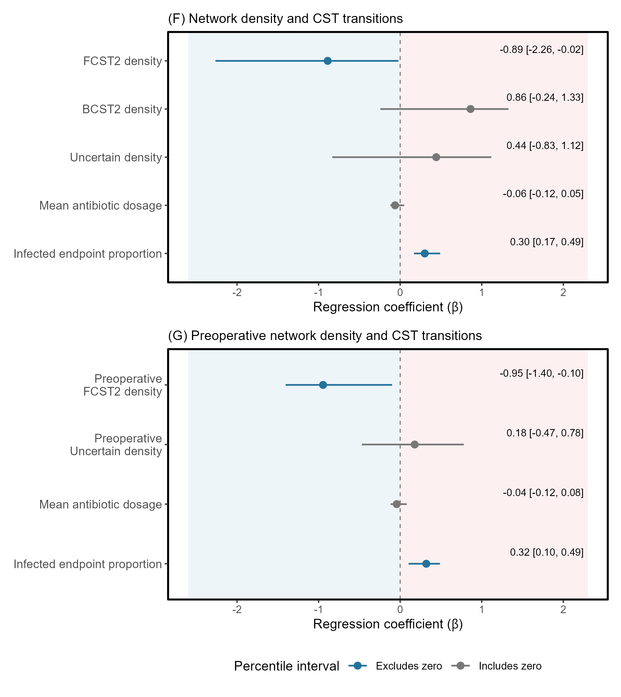

Panels A–G are drawn from final plotting tables. Panel C uses recovered adjacent-sample transition counts. Panels F–G reproduce the archived 30-outer × 200-inner bootstrap estimates shown in the manuscript; these are not newly estimated results. The recovery and numerical-stability checks are documented separately.

Open this file in RStudio and click **Knit**, or run `rmarkdown::render("fig4/fig4.Rmd")` from the repository root. Keep the CSV files beside this Rmd. PDF and PNG files are written to the same folder.

```{r setup, include=FALSE}
knitr::opts_chunk$set(echo=TRUE, message=FALSE, warning=TRUE, error=FALSE,
                      fig.width=10, fig.height=6, out.width="100%", dpi=120)

```

## Input files

```{r inputs, echo=FALSE}
knitr::kable(data.frame(File=list.files(pattern="[.]csv$")), col.names="File")
```


## Plot settings

```{r figure4-section1}
library(ggplot2)
library(patchwork)
# Run scripts from the Figure folder. All inputs are final plotting tables.
read_table <- function(name) read.csv(name, encoding="UTF-8", check.names=FALSE)
figure_theme <- theme_bw(base_size=10, base_family="Arial") +
  theme(panel.grid=element_blank(), panel.border=element_rect(colour="black", fill=NA, linewidth=0.7),
        strip.background=element_blank(), legend.position="bottom")
theme_set(figure_theme)
save_plot <- function(p, name, width, height) {
  
  ggsave(paste0(name, ".pdf"), p, device=cairo_pdf, width=width, height=height, units="mm")
  ggsave(paste0(name, ".png"), p, device=ragg::agg_png, width=width, height=height, units="mm", dpi=300)
}
```


## A–B. Classification stability and prevalence

```{r figure4-section2}
a <- read_table("stability_scores.csv")
a$Metric <- factor(a$Metric, levels=c("RI", "ARI", "NMI"))
avg <- aggregate(Score ~ Metric, a, mean)
p_a <- ggplot(a, aes(Metric, Score)) +
  geom_boxplot(width=.55, fill="#BFDDE5", linewidth=.35, outlier.size=.8) +
  geom_text(data=avg, aes(label=sprintf("%.2f",Score), y=Score+.08), size=3) +
  scale_y_continuous(breaks=seq(0,1,.25)) + coord_cartesian(ylim=c(0,1.08)) +
  labs(x=NULL,y="Score",title="(A) CST assignment stability")
b <- read_table("cst_prevalence.csv")
b$Timepoint <- factor(b$Timepoint,levels=paste0("T",0:3))
b$Label_y <- b$Percentage + ifelse(b$CST=="Uncertain", -4, 3)
cols <- c(BCST2="#F8766D",BCST3="#A3A500",BCST4="#00BFC4",FCST1="#C77CFF",FCST2="#FF9900",Uncertain="#E6B400")
p_b <- ggplot(b,aes(Timepoint,Percentage,colour=CST,group=CST)) +
  geom_line(linewidth=.5) + geom_point(size=1.5) +
  geom_text(data=subset(b,Count>0),aes(y=Label_y,label=sprintf("%.1f%%",Percentage)),vjust=0,size=2.5,show.legend=FALSE) +
  scale_colour_manual(values=cols) + scale_y_continuous(breaks=seq(0,100,25),limits=c(0,100)) +
  labs(x=NULL,y="Proportion (%)",title="(B) CST prevalence",colour="Sample class")
save_plot(p_a,"figure4A",95,85)
save_plot(p_b,"figure4B",140,95)
save_plot(p_a+p_b+plot_layout(widths=c(1,1.4)),"figure4AB",230,100)
```


```{r figure4-preview2, echo=FALSE}
knitr::include_graphics(c("figure4AB.png"))
```


## C. Transitions among primary CSTs

The edge table contains 577 transitions among the three displayed CSTs, including self-transitions. Adjacent samples were paired within each patient before restricting the graph to these states; transitions through other CSTs were not bridged.

```{r figure4-C}
library(igraph)
edges <- read_table("cst_transition_edges.csv")
nodes <- read_table("cst_transition_nodes.csv")
g <- graph_from_data_frame(edges[, c("From", "To", "Count")], directed=TRUE,
                           vertices=nodes)
xy <- cbind((nodes$x - 65)/30, (nodes$y + 145)/30)
plot_transition_network <- function() {
  par(mar=c(1,1,2,1), family="Arial")
  plot(g, layout=xy, rescale=FALSE, xlim=c(-1.6,1.9), ylim=c(-1.6,1.6),
       vertex.size=20, vertex.color=adjustcolor("skyblue", alpha.f=.8),
       vertex.frame.color="darkblue", vertex.label=NA,
       edge.width=E(g)$Count/max(E(g)$Count)*10,
       edge.arrow.size=.4, edge.curved=.2,
       edge.color=adjustcolor("darkred", alpha.f=.5))
  text(xy[,1]+c(.1,-.15,-.25), xy[,2]+c(.47,-.55,.48),
       labels=nodes$CST, cex=.9)
  title(main="(C) CST transitions", adj=0, font.main=1, cex.main=1)
}
cairo_pdf("figure4C.pdf", width=110/25.4, height=100/25.4, family="Arial")
plot_transition_network()
dev.off()
ragg::agg_png("figure4C.png", width=110, height=100, units="mm", res=300)
plot_transition_network()
dev.off()
```

```{r figure4-preview-C, echo=FALSE}

```

## D. Transition probabilities

```{r figure4-section3}
d <- read_table("transition_probabilities.csv")
s <- read_table("transition_statistics.csv")
d$Transition <- factor(d$Transition,levels=s$Transition)
d$Group <- factor(d$Group,levels=c("Non_infected","Infected"))
p <- ggplot(d,aes(Transition,Probability,fill=Group)) +
  geom_col(position=position_dodge(.75),width=.65,colour="black",linewidth=.2) +
  geom_text(aes(label=sprintf("%.1f%%",Probability*100)),position=position_dodge(.75),vjust=-.5,size=3) +
  scale_fill_manual(values=c(Non_infected="#69B3A2",Infected="#F8797C"),labels=c("w/o","w/")) +
  scale_y_continuous(labels=scales::label_percent(accuracy=1),breaks=seq(0,.16,.04),limits=c(0,.17)) +
  labs(title="(D) CST transition probability",x=NULL,y="Transition probability",fill="Infection status",
       caption=paste(sprintf("%s: OR %.2f (95%% CI %.2f-%.2f), P = %.3f",s$Transition,s$OR,s$CI_lower,s$CI_upper,s$P_value),collapse="\n")) +
  theme(plot.caption=element_text(hjust=0,size=8))
save_plot(p,"figure4D",145,115)
```


```{r figure4-preview3, echo=FALSE}
knitr::include_graphics(c("figure4D.png"))
```


## E. Network metrics

```{r figure4-section4}
d <- read_table("network_metrics.csv")
d$Network <- factor(d$Network,levels=c("FCST2","Uncertain","BCST2"))
metric_names <- c(assortativity="Assortativity",avg_degree="Average degree",avg_path_length="Average path length",density="Density",diameter="Diameter",edge_count="Edge count",node_count="Node count",transitivity="Transitivity")
d$Metric <- factor(d$Metric,levels=names(metric_names),labels=metric_names)
cols <- c(BM1="#A51C36",BM2="#7ABBDB",BM3="#84BA42",BM4="#682487",FM1="#DBB428",FM2="#D4562E")
p <- ggplot(d,aes(Network,Value,colour=Module,group=Module)) +
  geom_line(linewidth=.45) + geom_point(aes(shape=Network),size=2) +
  facet_grid(Metric~Kingdom,scales="free_y",switch="y") +
  scale_colour_manual(values=cols) + scale_shape_manual(values=c(FCST2=17,Uncertain=15,BCST2=16)) +
  labs(title="(E) Network metrics by CST and module",x=NULL,y=NULL,colour="CAM",shape="Network") +
  theme(strip.placement="outside",axis.text.x=element_text(angle=35,hjust=1),legend.position="top")
save_plot(p,"figure4E",180,260)
```


```{r figure4-preview4, echo=FALSE}
knitr::include_graphics(c("figure4E.png"))
```


## F–G. Network density and CST transitions

Points and intervals are read directly from the recovered source table. The table contains 28 valid outer estimates for F and 29 for G, out of 30 attempted outer resamples. Antibiotic dosage is a continuous dose variable, not an exposure rate. No OLS P values are added.

```{r figure4-FG}
coefficients <- read_table("nested_bootstrap_coefficients.csv")
term_labels <- c(fungi2_Density="FCST2 density",
                 bacteria2_Density="BCST2 density",
                 uncertain_Density="Uncertain density",
                 Preop_fungi2_Density="Preoperative\nFCST2 density",
                 Preop_uncertain_Density="Preoperative\nUncertain density",
                 abx_dose_g="Mean antibiotic dosage",
                 inf_rate="Infected endpoint proportion")
forest_plot <- function(model_id) {
  d <- coefficients[coefficients$model==model_id, ]
  d$Label <- factor(term_labels[d$term], levels=rev(term_labels[d$term]))
  d$Interval <- factor(ifelse(d$lower*d$upper>0,"Excludes zero","Includes zero"),
                       levels=c("Excludes zero","Includes zero"))
  ggplot(d, aes(x=estimate, y=Label)) +
    annotate("rect",xmin=-2.6,xmax=0,ymin=-Inf,ymax=Inf,fill="#EAF3F8",alpha=.8) +
    annotate("rect",xmin=0,xmax=2.3,ymin=-Inf,ymax=Inf,fill="#FBECEE",alpha=.8) +
    geom_vline(xintercept=0,linetype="dashed",linewidth=.35,colour="grey45") +
    geom_segment(aes(x=lower,xend=upper,yend=Label,colour=Interval),linewidth=.6) +
    geom_point(aes(colour=Interval),size=2.2) +
    geom_text(aes(x=2.25,label=sprintf("%.2f [%.2f, %.2f]",estimate,lower,upper)),
              hjust=1,vjust=-1.1,size=2.7,colour="black") +
    scale_colour_manual(values=c("Excludes zero"="#24729B","Includes zero"="#777777")) +
    scale_x_continuous(breaks=c(-2,-1,0,1,2)) +
    coord_cartesian(xlim=c(-2.6,2.3),clip="off") +
    labs(x=expression("Regression coefficient ("*beta*")"),y=NULL,
         colour="Percentile interval",
         title=if(model_id=="F") "(F) Network density and CST transitions" else
           "(G) Preoperative network density and CST transitions") +
    figure_theme + theme(plot.title=element_text(size=10),
                          axis.text.y=element_text(size=9),
                          legend.text=element_text(size=8))
}
p_f <- forest_plot("F")
p_g <- forest_plot("G")
save_plot(p_f,"figure4F",165,100)
save_plot(p_g,"figure4G",165,100)
save_plot(p_f/p_g + plot_layout(guides="collect"),"figure4FG",165,185)
```

```{r figure4-preview-FG, echo=FALSE}

```

## Session information

```{r session-info}
sessionInfo()
```
